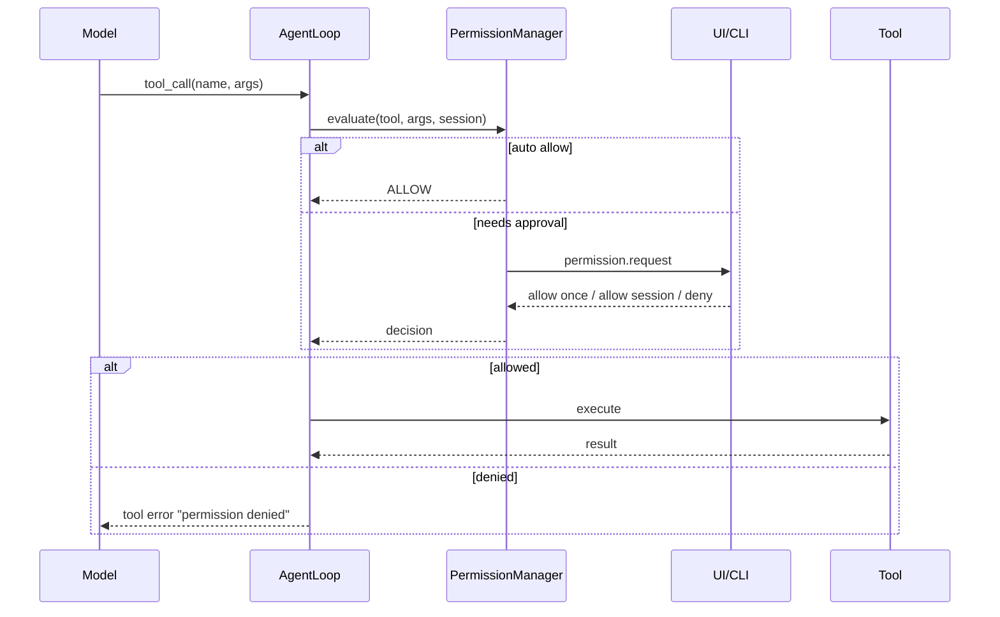

# Jade 权限检查方案

> 状态：已实现（v1）  
> 日期：2026-11-15  
> 适用项目：`java-coding-agent`（Jade 1.0.0）  
> 关联设计：[沙箱方案](SANDBOX.md)

## 1. 目标

在 AgentLoop 执行工具前增加一层可审计的用户授权，覆盖三类动作：

1. **本地文件写入**：新建、覆盖、编辑、删除工作区文件。
2. **危险命令**：删除、提权、重置历史、强推、批量改权限等。
3. **网络访问**：下载依赖、访问外部 URL、克隆仓库、启动可被外部访问的服务。

非目标：

- 不把权限提示当成安全沙箱。用户批准后，代码仍以当前用户权限运行。
- 不阻止恶意代码在已批准的命令内部做别的事（例如 `python -c` 读写文件）。
- 不在 v1 做持久化的“永久允许”策略；只支持本次、本会话。
- 不拦截只读操作；读文件、列目录、搜索默认放行。

## 2. 为什么需要

当前 `AgentLoop.executeTools` 直接执行模型选择的工具：

- `write_file` / `edit_file` 会直接改工作区；
- `run_command` 受危险命令正则和路径 jail 约束，但没有逐步确认；
- `compile_code` / `run_code` 直接运行编译器和程序；
- 网络是否可用取决于 OS sandbox 的全局开关，不区分命令和域名。

这意味着用户只能通过“取消”或事后检查来阻止动作。权限层要在动作发生前给出明确、可拒绝的请求。

## 3. 权限模式

新增 `PermissionMode`：

| 模式 | 文件写入 | 危险命令 | 网络 | 用途 |
|---|---|---|---|---|
| `balanced` | 每会话首次询问，之后放行 | 按风险询问 | 按命令/域名询问 | **默认** |
| `strict` | 每次写入都问 | 每次执行命令都问 | 每次联网都问 | 审阅/高风险 |
| `read-only` | 拒绝 | 拒绝 | 拒绝 | 只读分析 |
| `bypass` | 放行 | 只保留硬拒绝 | 放行 | 显式危险模式，必须显示警告 |

`bypass` 不通过普通 UI 默认暴露；CLI 使用 `--dangerously-skip-permissions`，Web 设置页需二次确认。

## 4. 默认策略（balanced）

| 动作 | 默认 | 说明 |
|---|---|---|
| `read_file`、`list_files`、`search_text` | 放行 | 只读，仍在路径 jail 内 |
| `write_file` / `edit_file` 新建文件 | 首次询问 | 选项：允许一次 / 本次会话允许全部编辑 / 拒绝 |
| 覆盖或编辑已有文件 | 首次询问 | 显示路径、字节数、diff 或内容摘要 |
| 写入 `.env`、`.git/`、`.ssh/`、`AGENTS.md` 等敏感路径 | 每次询问 | 不可会话放行 |
| `compile_code` | 放行 | 只写 `.agent-build` 构建产物 |
| `run_code` / `run_java` | 首次询问 | 执行模型生成的程序；可本次会话允许 |
| `run_command` 只读命令 | 放行 | `ls`、`cat`、`grep`、`git status` 等 |
| `run_command` 工作区写操作 | 按文件写入策略 | `mkdir`、`touch`、`cp`、`mv` 等 |
| `run_command` 危险命令 | 询问 | `rm -rf`、`git reset --hard`、`git clean -fdx`、`chmod 777`、`sudo` 等 |
| 网络命令 | 按主机询问 | `curl`、`wget`、`git clone/fetch/pull/push`、包管理器 |
| 绑定 localhost 服务 | 首次询问 | 例如 Spring Boot 启动；显示端口 |
| 工作区外路径 | 拒绝 | 路径 jail 直接拒绝，不给“允许”选项 |

### 4.1 文件写入不再每次打断

编码 Agent 的核心是连续写文件。默认每会话第一次写入时询问一次，用户可选择“本次会话允许全部编辑”；之后同工作区写入不再打断。`strict` 模式才逐次询问。

敏感路径永远单独询问，不继承会话授权。

### 4.2 危险命令分类

`CommandClassifier` 返回：

- `READ`：只读，自动放行。
- `WORKSPACE_WRITE`：工作区内写，跟随文件授权。
- `EXECUTE`：运行程序/脚本，首次会话询问。
- `DANGEROUS`：删除、提权、重置、强推、改权限，逐次询问。
- `NETWORK`：可联网，按域名询问。
- `UNKNOWN`：无法判断，默认询问（fail closed）。

分类器只做保守判断，不保证解析完整 shell。遇到以下情况直接 `UNKNOWN`：

- `bash -c`、`sh -c`、`eval`、命令替换 `$()`、反引号；
- `python -c`、`node -e`、`perl -e`；
- 管道到 shell（`curl ... | sh`）；
- 变量拼接出的命令；
- 自定义脚本路径。

硬拒绝（不可批准，直接报错）：

- `sudo`、`su`、`doas`
- `rm -rf /`、`rm -rf ~`、`rm -rf .`
- `mkfs`、`fdisk`、`parted`
- `dd` 写块设备
- fork bomb
- `shutdown`、`reboot`、`halt`
- 写 `/etc`、`/System`、`/Library`、`~/.ssh` 等宿主路径

硬拒绝先于权限弹窗，用户不能通过“允许”绕过。

### 4.3 网络授权

网络请求按主机展示：

```text
命令: curl -fsSL https://registry.npmjs.org/...
目标: registry.npmjs.org
风险: 外网访问
[允许一次] [本次会话允许该域名] [拒绝]
```

- `curl` / `wget`：解析 URL 主机。
- `git clone/fetch/pull/push`：解析 remote URL。
- `npm/pip/go`：显示默认 registry/proxy 主机。
- 无法静态确定：显示“可能联网”，按 `EXECUTE`/`UNKNOWN` 处理。
- localhost 绑定：询问端口，避免占用 Jade/Spring Boot 端口。
- 域名授权是“意图授权”，不是内核级域名过滤。真正的强制由 Docker 网络策略或本地 OS 网络开关完成。

## 5. 执行流程



关键行为：

- 审批期间运行状态为 `WAITING_APPROVAL`，不是 `RUNNING`。
- 审批请求阻塞当前工具调用，不阻塞其他 run。
- 用户拒绝后，工具返回错误结果，模型可以换方案，不直接终止 run。
- 超时（默认 300 秒）视为拒绝，并记录原因 `timeout`。
- 取消 run 会解除所有等待中的请求，记录 `cancelled`。
- 同一工具调用只发一次请求；重试必须重新授权。

## 6. 状态与事件

### 6.1 RunStatus

新增：

```text
WAITING_APPROVAL
```

`terminal()` 仍为 false；follow-up 被拒绝，直到审批完成或取消。

### 6.2 SSE 事件

`permission.request`：

```json
{
  "id": "perm-7f3a1c2e",
  "runId": "run-c66e8593",
  "tool": "run_command",
  "kind": "network",
  "risk": "medium",
  "summary": "访问 registry.npmjs.org",
  "detail": "npm install express",
  "target": "registry.npmjs.org",
  "options": ["once", "session", "deny"],
  "expiresAt": 1760000000000
}
```

`permission.resolved`：

```json
{
  "id": "perm-7f3a1c2e",
  "decision": "allow",
  "scope": "session",
  "reason": "user"
}
```

- `permission.request` 进入事件日志，页面刷新后可回放。
- 事件中不得出现 `.env` 内容、API key、完整环境变量。
- 文件 diff 只展示目标文件内容，不展示宿主机其他文件。

### 6.3 RunSnapshot

新增 `pendingPermission`（可选）：

```json
{
  "id": "perm-7f3a1c2e",
  "tool": "write_file",
  "kind": "file.write",
  "summary": "覆盖 src/Main.java",
  "risk": "medium"
}
```

用于页面刷新和 `GET /api/runs/{id}` 恢复待审批卡片。

## 7. API

```text
GET  /api/runs/{id}/permissions
  -> { pending: PermissionRequest[], recent: PermissionAudit[] }

POST /api/runs/{id}/permissions/{requestId}
  body: { "decision": "allow" | "deny", "scope": "once" | "session" }
  -> { run, requestId, decision, scope }
```

规则：

- 只有 `WAITING_APPROVAL` 且 requestId 匹配时接受。
- `scope=session` 只对同类动作生效：文件写、代码执行、域名、命令模式。
- `scope=session` 对敏感路径/硬拒绝无效。
- 重复提交返回 409，不重复执行。
- 404 不泄露其他 run 的 request id。
- 请求体最大 16 KB；reason 可选，最长 500 字符。

## 8. UI

### 8.1 待审批卡片

显示在 Live Trace 顶部，同时把 run 状态改为：

```text
WAITING FOR APPROVAL
```

卡片内容：

- 风险标签：`file write` / `dangerous` / `network` / `execute`。
- 工具名和动作摘要。
- 完整命令或文件路径。
- 覆盖文件显示 `diff`；新文件显示前 80 行/2 KB 内容。
- 网络显示主机和端口。
- 按钮：`Deny`、`Allow once`、`Allow for this session`。
- 倒计时/过期提示。

### 8.2 交互规则

- `Allow for this session` 对文件写：允许该 run 的所有工作区写入，但敏感路径除外。
- 对网络：只允许当前域名/端口，不放开全部网络。
- 对命令：只允许同类命令模式，不允许任意命令。
- 审批后卡片变为 `APPROVED` 并保留在 trace；拒绝变为 `DENIED`。
- 不能通过刷新页面绕过；刷新后重新显示 pending。
- 审批按钮提交期间禁用，防重复点击。
- 键盘：`A` 允许一次，`S` 会话允许，`D` 拒绝（焦点不在输入框时）。

### 8.3 新运行与历史

- `New run` 不继承会话授权。
- 历史 run 的授权记录只读展示，不重新开放。
- 服务重启时，未决请求标记为 `interrupted`，run 恢复为 FAILED（沿用现有中途重启语义）。

## 9. CLI

新增：

```text
--permission-mode balanced|strict|read-only|bypass
--dangerously-skip-permissions
```

- `balanced` 默认。
- 交互 TTY：打印请求后用 `[a]llow once / [s]ession / [d]eny` 读取。
- 非 TTY：默认拒绝，返回明确错误，不阻塞。
- `read-only`：写文件、执行、网络全部拒绝，只允许读/分析。
- `bypass`：跳过普通审批，但硬拒绝仍生效，并在启动时打印红色警告。

## 10. 审计与持久化

每次请求写 `.agent/permissions.jsonl`：

```json
{"ts":"...","id":"perm-...","tool":"write_file","kind":"file.write","decision":"allow","scope":"once","summary":"src/Main.java"}
```

- 不写文件内容、命令环境变量、API key。
- 运行结束后保留，随 workspace 一起删除。
- v1 不做跨 run 的“永久允许”；后续可在项目级配置中增加显式 allowlist。

## 11. 与沙箱的关系

| 层 | 作用 | 是否强制 |
|---|---|---|
| 权限检查 | 执行前询问用户，记录决定 | UX 层，可被恶意命令绕过 |
| 本地 `sandbox-exec` | 写目录、网络开关 | OS 层，但读全盘/共享内核 |
| 可选 Docker 插件 | 文件系统/进程/网络/资源隔离 | 强隔离，默认不启用 |

权限检查不能替代沙箱。用户在本地模式批准 `python -c` 后，该进程仍可能读取宿主文件；要真正限制，必须启用 Docker 插件。

网络授权在本地模式是“按命令允许网络”，不是域名级强制。Docker 的 `off`/`proxy` 模式才是强制边界。

## 12. 失败语义

- 审批请求超时：拒绝，工具输出 `Permission denied: timeout`，run 继续。
- 用户取消 run：所有等待请求返回 `cancelled`，run CANCELLED。
- UI 断线：请求仍挂起，重新连接后回放；超时后拒绝。
- 服务重启：未决请求 `interrupted`，run FAILED（现有恢复语义）。
- 策略配置非法：启动失败，不默认放行。
- 审计写入失败：记录警告，不阻塞执行（审计不是安全边界）。

## 13. 测试

单元：

- 文件写首次询问/会话放行/敏感路径再次询问。
- 危险命令分类：`rm -rf`、`git reset --hard`、`sudo`、`curl | sh`。
- 硬拒绝不可批准。
- 网络主机解析（curl/git/npm）。
- 权限模式 `balanced/strict/read-only/bypass`。
- 会话范围只作用于同类动作。

集成：

- AgentLoop 在 `WAITING_APPROVAL` 阻塞，允许后执行，拒绝后模型收到错误。
- 超时/取消/服务重启。
- Web API 409/404/400，SSE `permission.request`/`permission.resolved`。
- 页面刷新后 pending 仍在，审批后不重复执行。
- CLI TTY 和非 TTY 行为。
- 审计 JSONL 不含密钥或文件内容。

回归：

- 48 个现有测试通过。
- 本地默认不需要 Docker。
- 现有文件路径 jail、命令硬拒绝、沙箱开关不退化。

## 14. 待确认

1. 默认 `balanced` 是否接受“每会话首次写入询问一次”，而不是每次写入都问？
2. `run_code` / `run_java` 是否也按“首次执行询问”处理？
3. 网络授权是否接受“按主机/域名 + 本次会话允许”，而不是每次命令都问？
4. v1 是否只做 once/session，不做跨 run 的永久 allowlist？
5. 非 TTY CLI 默认拒绝，是否符合预期？

确认后按 `docs/superpowers/plans/2026-11-15-permissions.md` 开发。
