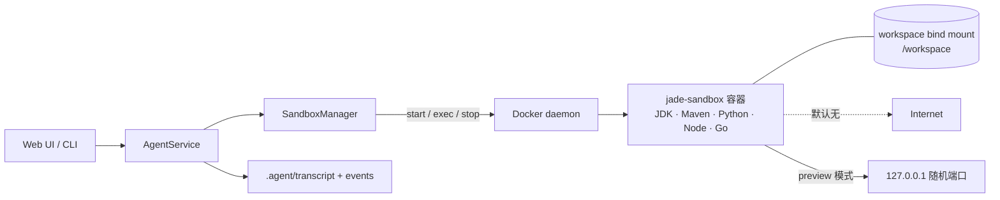

# Jade 沙箱方案（设计稿）

> 状态：待确认，未开始实现  
> 日期：2026-11-15  
> 适用项目：`java-coding-agent`（Jade 1.0.0）  
> 目标：把“本机直接执行”升级为可解释、可测试、默认安全的执行环境。

## 1. 结论

**当前有隔离，但不是安全沙箱。**

Jade 现在使用 macOS `sandbox-exec` 做写隔离：命令可以读整台机器，进程、内核、用户和主机运行时共享；只限制写目录，并默认拒绝网络。它能减少误写和误联网，不能隔离恶意代码，也不能替代容器或虚拟机。

Go 的例子正好暴露了边界：模型下载 Go SDK 到工作区，是因为执行环境直接使用本机 `PATH`；本机有 Go 才能跑，换一台机器就不成立。真正的沙箱应当自带工具链，不依赖宿主机安装了什么。

推荐目标架构：

- **每个会话一个 Docker 容器**，不是每条命令一个容器。
- 容器内预装 JDK、Maven、Python、Node、Go，宿主机不需要这些运行时。
- 只把当前 workspace 挂载到 `/workspace`，其他宿主路径不挂载。
- 默认无网络；依赖下载和 Web 预览使用两种显式的、可审计的例外模式。
- 保留当前 `sandbox-exec` 作为 `local` 后端和开发降级路径，但不再把它描述为“安全沙箱”。

## 2. 现状拆解

| 层 | 现在做什么 | 缺口 |
|---|---|---|
| 路径 | `Workspace` 做路径 jail，拒绝绝对路径、`..` 和 symlink 逃逸 | 只约束工具读写，不约束宿主机进程 |
| 命令 | `CommandSandbox` 调 `/usr/bin/sandbox-exec` | 允许全盘读；进程、PID、用户、内核共享 |
| 写 | 只允许 workspace、`.agent-build/tmp`、`/dev/null` | 不是只读根文件系统，没有磁盘配额 |
| 网络 | 默认 `(deny network*)`，可用环境变量打开 | 没有域名 allowlist、代理审计或按阶段授权 |
| 资源 | 命令超时、输出截断 | 没有 CPU、内存、PID、文件描述符限制 |
| 工具链 | `javac`/`java`、`python3`、`node`、`go` 来自宿主机 | 换机器就缺环境；版本不可复现 |
| 生命周期 | 命令级 `ProcessBuilder`；服务进程可能留在宿主 | 没有容器级停止、清理、端口生命周期 |
| 凭证 | 环境变量清洗、日志脱敏 | 子进程仍继承宿主环境的大部分变量 |

`sandbox-exec` 本身是 macOS 的私有兼容接口，不适合作为跨平台安全边界。当前实现应改名为 `local write jail`，避免“有 sandbox 字样就等于安全”的误判。

## 3. 威胁模型

### 3.1 要防的

- 模型生成的代码读取 `~/.ssh`、`~/.aws`、`.env`、其他项目文件。
- 代码写入 workspace 之外的目录，或修改 Jade 自身。
- 代码访问内网服务、云元数据、localhost 上的其他服务。
- 代码把 `DEEPSEEK_API_KEY`、GitHub token、SSH agent 带出。
- 代码耗尽 CPU、内存、PID、文件描述符，拖垮 Jade 或宿主机。
- 代码启动的 Web 服务永久占用端口或进程。
- 模型把 SDK、依赖、缓存写进项目目录，污染源码发现。

### 3.2 不承诺防的

- 宿主机内核 0-day、Docker daemon 被攻破、恶意镜像。
- 侧信道、CPU 微架构攻击。
- 多租户之间的强隔离；本方案是单用户本地 demo。
- 用户主动把宿主目录挂进容器，或把 `Docker socket` 挂进去。

如果目标是运行真正敌对的多租户代码，应使用 microVM（Firecracker、Apple Virtualization）或托管沙箱，而不是单机 Docker。

## 4. 方案比较

| 方案 | 隔离强度 | 工具链可复现 | 启动/实现成本 | 适合本项目 |
|---|---|---|---|---|
| 当前 `sandbox-exec` 写隔离 | 低：共享读、进程、内核 | 否，依赖宿主 | 已有 | 仅本地开发降级 |
| **Docker，每会话一容器** | 中：namespace/cgroup/挂载/网络隔离 | 是，镜像固定 | 中 | **推荐** |
| microVM（Firecracker 等） | 高 | 是 | 高，需虚拟化与镜像流水线 | 未来多租户 |
| 远程沙箱服务 | 高，取决于服务 | 是 | 高，需网络与服务端 | 未来云端 |

选 Docker 的理由：本机已有 Docker 28.3.2；能同时解决工具链、文件、网络、资源和端口问题；对本地 demo 的复杂度可控。选它不意味着“绝对安全”，但比当前写隔离高一个数量级。

## 5. 推荐架构



### 5.1 会话容器，不是命令容器

- `AgentService.start()` 为一个会话创建容器，容器名 `jade-<runId>`。
- 同一会话的所有 `run_command`、`compile_code`、`run_code` 都走 `docker exec`。
- follow-up 复用同一个容器；服务重启后容器可能已不在，follow-up 时重新创建，workspace 还在。
- `AgentService.close()`、取消、空闲超时、服务退出时 `docker stop`。
- 启动时清理带 `jade.session` 标签的孤儿容器。

每命令一个容器实现简单，但会丢失后台进程（Spring Boot 启动后容器退出）、缓存和会话状态，不适合作为目标方案。

### 5.2 镜像

新增 `sandbox/Dockerfile`，镜像名 `jade-sandbox:<version>`，至少包含：

- Eclipse Temurin JDK 21 + Maven 3.9
- Python 3.12 + pip
- Node.js 22 + npm
- Go 1.24 + gofmt
- `git`、`bash`、`curl` 仅保留排障必需项
- 非 root 用户 `coder`（UID 10001）
- 预热的 Maven/npm/pip/Go 缓存（能离线构建常见 demo）

镜像本身是供应链边界：版本固定、构建参数固定、发布 digest；不要 `FROM latest`，不要在运行时 `docker pull` 未固定 tag。

### 5.3 容器规格

建议的启动参数（实现时按 Docker 版本验证）：

```text
docker run -d --rm
  --name jade-<runId>
  --label jade.session=<runId>
  --init
  --read-only
  --tmpfs /tmp:rw,noexec,nosuid,size=256m
  --cap-drop=ALL
  --security-opt=no-new-privileges
  --pids-limit=256
  --memory=2g
  --cpus=2
  --ulimit nofile=1024:1024
  --user 10001:10001
  --workdir /workspace
  -v <workspace>:/workspace:rw
  jade-sandbox:<digest> sleep infinity
```

补充环境：

```text
HOME=/workspace/.agent-home
TMPDIR=/workspace/.agent-build/tmp
GOCACHE=/workspace/.agent-build/go-cache
GOMODCACHE=/workspace/.agent-build/go-mod
MAVEN_CONFIG=/workspace/.agent-build/m2
MAVEN_OPTS=-Dmaven.repo.local=/workspace/.agent-build/m2
JAVA_TOOL_OPTIONS=-Djava.io.tmpdir=/workspace/.agent-build/tmp
npm_config_cache=/workspace/.agent-build/npm
PIP_CACHE_DIR=/workspace/.agent-build/pip
```

注意：

- 根文件系统只读，工具链目录不可改。
- 工作区是唯一持久可写目录；`.agent-build` 不参与源码扫描。
- 不挂载 `~/.m2`、`~/.ssh`、`~/.gitconfig`、`/var/run/docker.sock`。
- 不把 `DEEPSEEK_API_KEY` 传给容器；Jade 的 LLM 调用在宿主机完成。
- 容器内只保留安全环境变量，使用显式 allowlist，不复用宿主环境。

### 5.4 网络策略

网络必须显式选择，不能“默认能上网”：

| 模式 | 用途 | 机制 | 默认 |
|---|---|---|---|
| `off` | 编译、运行、测试 | `--network none` | 是 |
| `proxy` | Maven/npm/pip/Go 下载 | 仅允许访问本地 allowlist 代理；代理记录域名和字节数 | 否 |
| `preview` | 启动 Web 服务并让本机访问 | 发布 `127.0.0.1:<ephemeral>`；优先尝试无外部出口的网络 | 否 |
| `on` | 临时排障 | 普通 bridge，有外部网络 | 否，必须显式设置并警告 |

已经验证：`--network none` 下 `docker port` 不返回映射；`--network internal` 也没有发布端口。也就是说“完全无网络”和“本机预览端口”不能简单同时成立。实现时需要一次小型 spike：

1. 优先验证自定义 bridge + 关闭 masquerade + 只发布 loopback 端口，确认容器不能访问公网、宿主仍能访问预览端口。
2. 如果 Docker Desktop 无法同时满足，`preview` 明确标记为“允许出网”，并在 UI 和控制台显示风险，不冒充无网络模式。
3. 不在文档里承诺做不到的隔离。

依赖下载不默认走 `on`。优先把依赖预装进镜像；需要拉取时用 `proxy` 模式，只允许 Maven Central、npm registry、PyPI、Go proxy 和项目明确声明的域名。代理日志写入 `.agent/network.log`，不记录 body 和凭证。

### 5.5 端口与预览

- 容器创建时用 `-p 127.0.0.1::<port>` 分配宿主机随机端口，避免占用 Jade 的 8080/8081。
- `docker port <container> <port>` 读取实际端口，写入 `RunSnapshot.previewUrls`。
- UI 在 inspector 显示 `Preview: http://127.0.0.1:<port>`；端口不写死。
- 后台启动服务通过 `run_command` 的 `background=true` 或专门的 `run_server` 工具：
  - 使用 `nohup ... > .agent-build/server.log 2>&1 & echo $!`；
  - 命令返回 PID，不等待服务退出；
  - `docker exec` 的 stdin/stdout 必须关闭/重定向，否则调用会挂住。
- 停止会话时先 `docker stop`，再清理端口映射；不依赖进程自己退出。

### 5.6 代码路径

新增 `workspace/sandbox` 包，避免继续把 Docker 细节塞进 `CommandRunner`：

```text
SandboxManager         选择 local/docker 后端，管理每个会话的 SandboxSession
SandboxSession         start / exec / exposePort / stop / status
SandboxSpec            image、workspace、网络模式、资源、端口
SandboxInfo            backend、containerId、network、limits、previewUrls
LocalSandboxSession    包装现有 CommandSandbox + ProcessBuilder
DockerSandboxSession   docker run/exec/port/stop
```

`CommandRunner` 保留现有签名，内部委托给 `SandboxSession.exec(...)`。`Verifier` 和所有 `run_command`、`compile_code`、`run_code` 不直接调用 `ProcessBuilder`，确保没有绕过路径。

`read_file`、`write_file` 仍在宿主侧走 `Workspace` 路径 jail；它们不执行代码，不需要容器。所有执行型工具必须走 sandbox session。

### 5.7 生命周期

```text
start(task)
  -> create workspace
  -> sandbox.start(workspace, spec)
  -> AgentLoop.run()
  -> tools/verifier use sandbox.exec()
  -> status SUCCEEDED/FAILED
  -> sandbox stays alive for follow-up (idle timeout 15 min)

followUp(message)
  -> reuse container if running
  -> else recreate container on same workspace
  -> continueSession()

close/cancel/idle
  -> docker stop, remove label, release port
```

服务启动时清理带 `jade.session` 标签但不在运行注册表中的容器；恢复的历史会话默认不启动容器，follow-up 时再启动。

## 6. 配置

建议新增并保留兼容：

| 变量 | 取值 | 默认 | 说明 |
|---|---|---|---|
| `AGENT_SANDBOX_BACKEND` | `auto` / `local` / `docker` / `required` | `auto` | `auto` 有 Docker 用 Docker，否则 local 并警告 |
| `AGENT_SANDBOX_IMAGE` | image:digest | `jade-sandbox:1` | 必须固定 digest |
| `AGENT_SANDBOX_NETWORK_MODE` | `off` / `proxy` / `preview` / `on` | `off` | 网络策略 |
| `AGENT_SANDBOX_MEMORY` | `2g` | `2g` | 容器内存 |
| `AGENT_SANDBOX_CPUS` | `2` | `2` | CPU 配额 |
| `AGENT_SANDBOX_PIDS` | `256` | `256` | PID 上限 |
| `AGENT_SANDBOX_IDLE_SECONDS` | `900` | `900` | 空闲回收 |
| `AGENT_SANDBOX_PREVIEW_PORTS` | `8080,3000,5173` | `8080` | 可发布端口 |
| `AGENT_SANDBOX_PROXY` | URL | 空 | `proxy` 模式的本地代理 |

兼容旧变量：

- `AGENT_SANDBOX=off|auto|required` 只控制 `local` 后端的 `CommandSandbox`：`off` 不套 `sandbox-exec`，`auto` 可用时套，`required` 不可用则拒绝启动。它**不**等于 `AGENT_SANDBOX_BACKEND=required`（后者要求 Docker）。两者同时设置时，新键优先。
- `AGENT_SANDBOX_NETWORK=true|false` 继续可用，分别映射到 `on|off`；新键 `AGENT_SANDBOX_NETWORK_MODE` 优先。

`--check` 和 `/api/config` 显示：backend、镜像、网络模式、资源上限、Docker 是否可用、最后一次拉取/启动错误。UI 在运行头显示 `sandbox: docker` 或 `sandbox: local-write-jail`，不再只写 `per-run dir`。

## 7. 失败语义

- `required`：Docker 不可用、镜像缺失、容器启动失败 → 拒绝启动 run，明确报错；不静默降级。
- `auto`：Docker 不可用 → 使用 local，并在启动日志、UI 和 run 事件中警告“非安全沙箱”。
- `docker`：意图明确；失败即失败，不回退。
- 网络模式不支持（例如 preview 端口无法发布）→ 启动前失败，或按配置显式降级为 `on` 并警告；不能悄悄改变。
- 命令超时：`docker exec` 的客户端超时后执行 `docker kill` 该 exec 会话，不能只杀宿主 CLI 进程；服务型后台命令由会话生命周期管理。
- 容器 OOM/退出：采集 `docker inspect` 的 exit code/OOMKilled，作为工具输出和 run 事件返回。

## 8. 安全边界

这套方案能把“代码能读宿主全盘、能继承宿主环境、能无限占资源”降为“只能读容器镜像和挂载的工作区，默认无网络，有资源上限”。

仍然保留：

- 容器与宿主共享内核；内核漏洞可穿透。
- Docker daemon 是高权限组件；不把 socket 暴露给容器，但 daemon 本身被攻破即失守。
- workspace 是双向挂载；容器对 workspace 的写入会回到宿主。这是产品需求，不是漏洞；不要在 workspace 中放 `.env` 或密钥。
- `preview` 模式可能允许出网，取决于 Docker Desktop 的能力；UI 必须展示实际模式。
- 镜像供应链需要固定 digest、扫描和最小化。

**不要把它描述成 VM 或“完全隔离”。** 准确说法是：容器级文件系统、进程、网络和资源隔离，默认无出网。

## 9. 迁移步骤

### Phase 0：方案确认（本文件）

- 确认 Docker 作为目标后端。
- 确认默认网络 `off`、预览模式单独授权。
- 确认镜像由项目维护，不依赖宿主运行时。

### Phase 1：骨架与镜像

- 新增 `SandboxManager`、`SandboxSession`、`SandboxSpec`。
- 新增 `sandbox/Dockerfile`、构建脚本、固定版本。
- `LocalSandboxSession` 包装现有 `CommandSandbox`，保持现有 34 个测试通过。
- `--check` 输出 backend 与 Docker 可用性。

### Phase 2：Docker 执行链

- `DockerSandboxSession.start/exec/stop`。
- `CommandRunner` 改为委托 session；`Verifier`、`run_command`、`compile_code`、`run_code` 全部走同一条路。
- workspace 路径映射 `/workspace`；非 workspace 路径拒绝。
- 容器内 Go/Java/Python/Node 可编译运行，无需宿主工具链。

### Phase 3：预览与连续会话

- 端口映射、`previewUrls`、UI preview 链接。
- 后台服务启动工具；Spring Boot 在容器内启动并由本机访问。
- follow-up 复用容器；重启后按需重建；空闲/关闭清理。
- 恢复会话不预启动容器。

### Phase 4：硬化与验证

- 网络 `off`、`proxy`、`preview` 的边界测试。
- 资源上限、OOM、PID、只读根、非 root、env 清洗测试。
- 容器逃逸/宿主文件/密钥/内网访问的负面测试。
- `mvn test`、镜像构建、真实多语言 run、Spring Boot preview、文档。
- 更新 `docs/ARCHITECTURE.md`、`README.md`、`docs/DEMO.md`。

### Phase 5：可选

- gVisor/Firecracker 或远程沙箱后端。
- 镜像 digest 发布、漏洞扫描、代理 allowlist 管理。

## 10. 验收标准

- 在没有安装 Go 的宿主机上，容器内 `compile_code`/`run_code` 仍能构建并运行 Go。
- 容器内不能读取宿主 `~/.ssh`、`~/.aws`、项目根 `.env`、Docker socket。
- 容器内不能写 `/workspace` 之外；`/` 只读，`/tmp` 是 tmpfs。
- 默认 `network=off` 时，容器内 `curl https://example.com` 失败；本机仍能访问 Jade。
- `preview` 模式下，Spring Boot 启动后能在 `127.0.0.1:<随机端口>` 返回 200；端口不占用 8080/8081。
- 容器 OOM/超时/退出能被工具层捕获，run 不会永久 RUNNING。
- 连续会话 follow-up 复用同一容器和工作区；服务重启后能恢复会话并在新容器继续。
- `AGENT_SANDBOX_BACKEND=required` 且 Docker 不可用时，启动失败并给出可操作错误。
- 现有 Java/Python/JavaScript/Go 测试、34 个测试全部通过；新增安全测试通过。

## 11. 待确认决策

1. 是否接受 Docker 作为默认后端？本机已有 Docker 28.3.2，但 Docker Desktop 需要保持运行。
2. `preview` 是否允许在无法同时做到“无出网 + 发布端口”时显式降级为 `on`，还是直接拒绝？
3. 镜像是否随项目发布（体积较大），还是由 `scripts/build-sandbox.sh` 本地构建？
4. 是否把 `local write jail` 保留为明确的手动降级选项，还是完全移除？
5. 是否接受每次会话启动容器的 1–3 秒额外延迟，以换取隔离？

确认后按 `docs/superpowers/plans/2026-11-15-container-sandbox.md` 开发。
