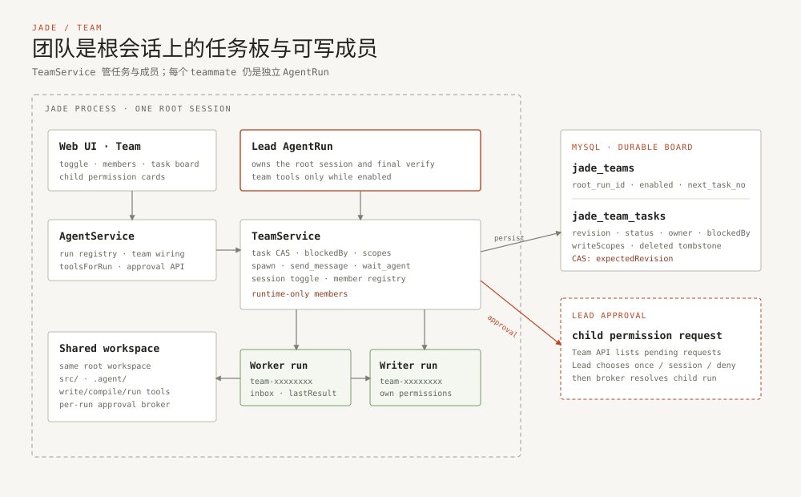
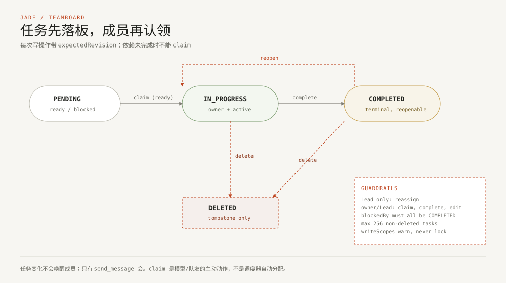
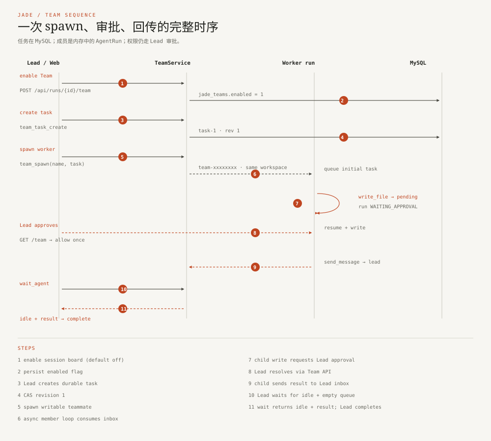

# Jade Agent Team / TeamBoard 实现

> 状态：已实现（2026-11-26，Jade 1.4.0，163 tests）。
> 提交：`b9fb752 feat: 实现 Team/TeamBoard 团队任务分派`。
> 设计背景和 DSH 对照见 `docs/superpowers/specs/2026-11-25-agent-team-design.md`。

## 1. 结论

Jade 的 Team 不是另一个调度器，也不是多进程集群。它是根会话（Lead）上的一块持久任务板，加上若干共享同一 workspace 的可写 teammate。

三条约束决定了实现形态：

1. **任务先落板。** 任务、owner、依赖、revision 存在 MySQL，模型不能靠上下文记住分工。
2. **成员是可继续的 AgentRun。** 每个 teammate 有自己的 transcript、事件流、权限 broker 和 inbox，不是一次性的 `delegate_task`。
3. **Lead 保留审批和最终验证。** teammate 可以写文件、编译、运行，但 pending 权限统一回到 Lead；最终回答和 workspace 验收仍由 Lead 负责。

Team 默认关闭。关闭时任务和历史成员保留，`team_*` / `team_spawn` 工具与 Team 入口隐藏。

## 2. 与 DSH 的对应关系

| DSH | Jade |
|---|---|
| root Session + continuable descendants | root `AgentRun` + `team-*` child runs |
| Team mode per root, default off | `jade_teams.enabled` + `AGENT_TEAM_ENABLED=false` |
| versioned `team/task` events | `jade_team_tasks` + `revision` CAS |
| 4 个 team tools | 8 个：4 个任务工具 + spawn/list/send/wait |
| read-only TeamBoard | Team drawer 中只读 board + 成员/审批 |
| Lead-only reassign | `TeamService` 校验 Lead |
| advisory writeScopes | 相同：只告警，不锁文件 |
| 冷成员不恢复 | 相同：任务恢复，成员运行时状态不恢复 |

Jade 没有照搬“只读 teammate”的 v1。用户明确选择最终版：teammate 可写、无 depth/member 上限、Lead 审批。

## 3. 总体结构



图中四个边界：

- **Jade process**：单进程，TeamService 和所有成员共享 JVM。
- **MySQL**：任务板的 durable source of truth。
- **Shared workspace**：teammate 和 Lead 直接读写同一个 run workspace。
- **Lead approval**：子 run 的权限请求通过 Team API 回到 Lead，不在后台自动放行。

`TeamService` 只持有 root 到成员的运行时映射；任务本身不依赖成员是否在线。服务重启后，board 还在，但 cold members 会从内存消失。

## 4. 角色和模式

### 4.1 Lead

root `AgentRun` 就是 Lead：

- 创建/编辑/依赖/分配任务；
- 开启或关闭 Team；
- spawn teammate；
- 审批 teammate 的权限请求；
- 运行 Goal/verification，输出最终答案。

### 4.2 Teammate

`team-xxxxxxxx` 是新的 `AgentRun`：

- 共享 root workspace；
- 可写、可编译、可运行、可执行命令；
- 不能 `ask_user`（避免多个成员同时向用户提问）；
- 有 `team_*`、`list_agents`、`send_message`、`wait_agent`；
- 不进行 Goal review，不写长期记忆；
- 每次 `memberLoop` 消费 inbox，跑一个可继续的 model turn。

### 4.3 权限

每个 teammate 有自己的 `PermissionBroker`。 `write_file`、`run_command` 等触发审批后：

```text
teammate broker → TeamService.pendingPermissions(root)
                → GET /api/runs/{root}/team
                → Lead: allow once / allow for session / deny
                → POST /api/runs/{root}/team/permissions/{id}
                → teammate broker resolves
```

Team 工具本身在 `PermissionPolicy.READ_TOOLS` 里，不需要逐次审批；真正的高风险动作仍然走权限层。

## 5. 任务模型

### 5.1 字段

```java
record TeamTask(
    String id,            // task-1, task-2...
    long revision,        // CAS
    String subject,       // 1..200
    String description,   // 0..16384
    TeamTaskStatus status,// PENDING, IN_PROGRESS, COMPLETED, DELETED
    String ownerId,       // team-* run id
    String ownerName,
    List<String> blockedBy,
    List<String> writeScopes,
    long createdAt,
    long updatedAt
) {}
```

`blockedBy` 和 `writeScopes` 在 MySQL 中以 JSON 列保存。没有单独依赖表；任务量上限 256，读全表后做 DAG 校验足够。

### 5.2 MySQL

```sql
CREATE TABLE jade_teams (
  root_run_id VARCHAR(80) PRIMARY KEY,
  enabled TINYINT(1) NOT NULL DEFAULT 0,
  next_task_no BIGINT NOT NULL DEFAULT 1,
  created_at BIGINT NOT NULL,
  updated_at BIGINT NOT NULL
);

CREATE TABLE jade_team_tasks (
  root_run_id VARCHAR(80) NOT NULL,
  task_id VARCHAR(40) NOT NULL,
  revision BIGINT NOT NULL,
  subject VARCHAR(200) NOT NULL,
  description MEDIUMTEXT NOT NULL,
  status VARCHAR(24) NOT NULL,
  owner_id VARCHAR(80) NULL,
  owner_name VARCHAR(80) NULL,
  blocked_by_json TEXT NOT NULL,
  write_scopes_json TEXT NOT NULL,
  created_at BIGINT NOT NULL,
  updated_at BIGINT NOT NULL,
  PRIMARY KEY(root_run_id, task_id),
  KEY idx_team_status(root_run_id, status)
);
```

`TeamStores.create(MysqlSettings)` 连接 MySQL；连接失败时回退到内存 store，并写日志。这个 fallback 让本地 demo 仍可启动，但生产/验收必须看 `team` health，而不是假设 MySQL 生效。

### 5.3 CAS

所有变更都带 `expectedRevision`：

```java
if (task.revision() != expectedRevision) {
    throw new IllegalStateException("team task revision changed; refresh the board");
}
TeamTask saved = store.save(root, task, next);
if (saved == null) {
    throw new IllegalStateException("team task revision changed; refresh the board");
}
```

MySQL 的第二道保护是：

```sql
UPDATE jade_team_tasks
SET revision = #{next.revision}, ...
WHERE root_run_id = #{rootRunId}
  AND task_id = #{taskId}
  AND revision = #{expected.revision}
```

更新 0 行就是 stale。任务事件不单独建 event 表，UI 每次刷新 board；这比 DSH 的 versioned event journal 简单，但少了完整的任务审计史。

## 6. 任务生命周期



状态机保持最小：

- `PENDING → IN_PROGRESS`：claim；所有 blocker 必须 completed。
- `IN_PROGRESS → COMPLETED`：complete；owner 或 Lead。
- `COMPLETED → IN_PROGRESS`：reopen；owner 或 Lead。
- 任意非删除 → `DELETED`：Lead 或 owner；被依赖的任务不能删。
- `DELETED` 是 tombstone，不再出现在默认列表。

`writeScopes` 只做 UI 提示。两个任务写同一路径不会互相阻塞；这是 advisory，不是文件锁。

## 7. 时序



一次典型流程：

1. Lead 通过 `POST /api/runs/{id}/team` 打开 session board。
2. `team_task_create` 写入 MySQL，得到 `task-N` 和 `revision`。
3. `team_spawn` 创建 `team-*` child，加入共享 workspace，inbox 放入初始任务。
4. 虚拟线程里的 `memberLoop` 调用 `runTeamTurn` 跑可写 turn。
5. child 的 `write_file` 进入 `WAITING_APPROVAL`；Team API 暴露 pending。
6. Lead 在 Team drawer 选择 allow once；broker 恢复 child。
7. child 完成并 `send_message` 回 Lead inbox。
8. Lead `wait_agent` 看到 idle + result，更新任务并做最终验证。

## 8. 工具和 API

### 8.1 工具

| 工具 | 作用 |
|---|---|
| `team_task_create` | 创建任务，subject/description/blockedBy/writeScopes |
| `team_task_list` | 按 status/owner/unowned/ready 过滤 |
| `team_task_get` | 读取完整 description |
| `team_task_update` | claim/release/edit/complete/reopen/reassign/delete/set_dependencies |
| `team_spawn` | 创建可写 teammate，队列初始任务 |
| `list_agents` | 成员状态、当前任务、最后结果/错误 |
| `send_message` | 给 Lead 或其他 teammate 排队消息 |
| `wait_agent` | 等 idle + inbox 空；超时只结束观察，返回 stillRunning/queued/completed/failed |

任务工具自动放行；spawn/send/wait 也是协调元数据，不直接写文件。真正的文件/命令权限仍由 child broker 审批。

#### wait_agent 超时语义

`wait_agent` 默认等 600 秒，可传 `timeoutSeconds` 1–1800。若任一目标成员出现待审批权限请求，立即返回 `waitingApproval` 与 `pendingPermissions`，不等待 300 秒权限超时。真正的超时只是**观察窗口结束**：

- 不取消 teammate 的 `AgentRun`，不改任务状态/owner，不自动 reassign 或 spawn 替代成员；
- 返回 `timedOut`、`waitedMillis`，并把成员分成 `stillRunning`、`queued`、`completed`、`failed`、`idle`；
- 输出明确提示：仍在运行的成员不是失败，不要为它们重新分派或创建重复成员；先 `list_agents` + 任务板，再 `send_message` 或再次 `wait_agent`；
- 有 `waitingApproval` 时，先让用户/Lead 在 Team 对话框或 API 批准，再决定是否继续等待；不要重派或重复 spawn；
- `wait_agent` 只判断成员 idle/inbox 与 pending permission，不判断任务 completed；Lead 必须同时看任务板。

因此长任务可以继续跑；真正需要处理的是 Lead 的等待策略，不是运行时的任务取消。

### 8.2 HTTP

```text
GET  /api/runs/{id}/team
POST /api/runs/{id}/team                    {enabled:true|false}
GET  /api/runs/{id}/team/tasks/{taskId}
POST /api/runs/{id}/team/permissions/{requestId}
     {decision:"allow"|"deny", scope:"once"|"session"}
```

`GET /api/runs` 的列表过滤 `team-*` / `sub-*`，避免内部 child 污染 Session 栏；直接 GET 单个 child 仍可用，Team drawer 仍能看到成员。

### 8.3 UI

Team drawer 是只读 board，不做拖拽：

- enable/disable toggle；
- members：running/idle、currentTask、lastResult、lastError；
- tasks：id/revision/status/owner/subject/description；
- pending child permissions：Deny / Allow once / Allow for session。

和 DSH 一样，任务创建/修改由模型工具完成，UI 只做观察和审批。

## 9. 核心代码

### 9.1 按角色装配工具

`AgentService.toolsForRun` 决定谁是 Lead、谁是 teammate、谁仍是只读 subagent：

```java
private ToolRegistry toolsForRun(AgentRun run) {
    if (team.isMember(run)) {
        ToolRegistry registry = new ToolRegistry();
        for (Tool tool : BuiltInTools.all()) {
            if (!tool.spec().name().equals("ask_user")) {
                registry.register(tool);
            }
        }
        TeamToolset.register(registry, team, run);
        return registry;
    }
    if (run.state().isSubagent()) {
        return subagentTools(); // read-only
    }
    ToolRegistry registry = new ToolRegistry().registerAll(tools.all());
    registry.register(new DelegateTaskTool(subagents(), run));
    if (team.enabledFor(run)) {
        TeamToolset.register(registry, team, run);
    }
    return registry;
}
```

注意：teammate 拿的是 built-ins，不包含 MCP 工具。MCP 仍只对 root/普通 subagent 路径开放；如果以后要让 teammate 用 MCP，需要在 `toolsForRun` 里明确合并，而不是顺手放开。

### 9.2 spawn 一个可写成员

```java
public TeamMember spawn(AgentRun actor, String requestedName, String task) {
    String root = requireEnabledRoot(actor);
    if (task == null || task.isBlank()) throw new IllegalArgumentException("task is required");
    String name = uniqueName(root, requestedName);
    AgentRun child = agents.newTeamRun(actor, root, name, task);
    TeamMember member = new TeamMember(child.id(), name, root, actor.id(), child);
    membersById.put(child.id(), member);
    membersByRoot.computeIfAbsent(root, ignored -> new CopyOnWriteArrayList<>()).add(member);
    member.inbox().offer(new TeamMember.InboxMessage(task, false));
    executor.submit(() -> memberLoop(member));
    return member;
}
```

`newTeamRun` 用 `Workspace.open(parent.workspace().root())` 指向同一目录；不是复制 workspace，也没有 worktree 隔离。

### 9.3 memberLoop

```java
private void memberLoop(TeamMember member) {
    while (!closed && !member.closed()) {
        TeamMember.InboxMessage message = member.inbox().take();
        member.running(true);
        member.currentTask(message.text());
        member.lastError(null);
        try {
            RunSnapshot snapshot = agents.runTeamTurn(member, message.text(), message.continuation());
            member.lastResult(snapshot.finalAnswer() == null
                    ? snapshot.status() : snapshot.finalAnswer());
        } catch (Throwable t) {
            member.lastError(t.getMessage());
        } finally {
            member.running(false);
            synchronized (member.monitor()) {
                member.monitor().notifyAll();
            }
        }
    }
}
```

`runTeamTurn` 会 `beginTurn`、注入 Team policy、跳过 Goal review、跳过长期记忆写入，最后 `finishTurn` 但**不关闭** event log——这是成员能继续接收消息的前提。

### 9.4 权限回传

```java
public List<Map<String, Object>> pendingPermissions(String rootRunId) {
    List<Map<String, Object>> result = new ArrayList<>();
    for (TeamMember member : membersByRoot.getOrDefault(rootRunId, List.of())) {
        PermissionRequest request = member.run().permissions().pendingFor(member.id());
        if (request != null) {
            Map<String, Object> row = new LinkedHashMap<>(request.publicView());
            row.put("memberId", member.id());
            row.put("memberName", member.name());
            result.add(row);
        }
    }
    return result;
}
```

这里有一个容易写错的点：`pendingFor` 的参数是 **run id**，不是 request id；一开始传错会导致 Team drawer 永远看不到 child 的请求。

### 9.5 任务 CAS

```java
TeamTask next = switch (action) {
    case "claim" -> task.ownedBy(ownerId, ownerName, TeamTaskStatus.IN_PROGRESS, now);
    case "complete" -> task.withStatus(TeamTaskStatus.COMPLETED, now);
    // ...
    default -> throw new IllegalArgumentException("unknown task action: " + action);
};
TeamTask saved = store.save(root, task, next);
if (saved == null) {
    throw new IllegalStateException("team task revision changed; refresh the board");
}
```

## 10. 运行和验收

```bash
cd java-coding-agent
./run.sh --check              # 应看到 team default off / MySQL
./run.sh --port 8081
```

打开 UI，选择一个 root session，点 Team → Enabled，然后让 Lead：

```text
Create a team task "Audit README" and spawn a worker to inspect the README.
Wait for the worker's message and report its result.
```

实际验收证据：

- MySQL board：`task-1 Audit PENDING revision 1` 在服务重启后仍在；
- worker：`child-done`，`send_message` 把 `worker-done` 送回 Lead；
- writer：`write_file` 触发 `perm-8a5bf30b`，Lead 在 Team drawer allow once，child 回复 `child-wrote`；
- 测试：`TeamTaskStoreTest` 3 + `TeamServiceTest` 1 + `WebServerTest.teamApiTogglesSessionBoard`；
- 全量 `mvn test`：163 tests，0 failures。

## 11. 限制和安全边界

1. **单进程。** 所有成员共享 JVM、workspace 和宿主工具链；不是容器/VM 隔离。
2. **advisory writeScopes。** 不锁文件，两个 teammate 可以同时写同一路径；冲突由 Lead 最终 review/verification 发现。
3. **冷成员不恢复。** MySQL 恢复任务和 enabled，但成员是运行时对象；重启后需要 Lead 重新 spawn。
4. **无自动 owner 释放。** teammate 崩溃后任务仍显示 IN_PROGRESS；需要 Lead reopen/reassign。
5. **任务变更不唤醒成员。** 只有 `send_message` 会推进 idle 成员。
6. **Team 关闭不等于删除。** 任务和成员历史保留，工具/入口隐藏。
7. **默认 off。** `AGENT_TEAM_ENABLED=false`；当前测试 root 显式开启。

## 12. 后续

- 任务事件审计：把 `team_task.*` 写入 `jade_events`，支持历史回放。
- 成员恢复：把 member 注册信息持久化，重启后标记 offline 并可显式恢复。
- 可选 worktree 隔离：在保留共享 board 的前提下，让每个写入者独立 worktree，再由 Lead merge。
- 冲突提示：read/write scope 与最近文件 hash 结合，写前 warning。
- Team eval：用 DSH 的任务集对比“单 Agent vs Team”的成功率、token、冲突率。
